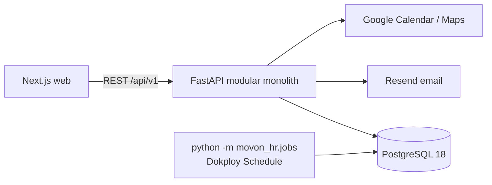

# Architecture

- **Web** (`apps/web`) hanya me-render UI dan memanggil `/api/v1` lewat proxy Next. Lihat ADR 0001.
- **API** (`apps/api`) adalah satu proses FastAPI async. Setiap domain (auth, employees, attendance, leave, payroll, policies, settings, notifications, audit, dashboard) adalah satu modul di `src/movon_hr/modules/`. Lihat ADR 0002 dan aturan modul di `apps/api/AGENTS.md`.
- **PostgreSQL 18** adalah satu-satunya penyimpanan. Setiap request berjalan dalam satu transaksi. Alembic (`apps/api/alembic`) satu-satunya pemilik skema; API tidak membuat tabel saat startup.
- **Tenant**: setiap perusahaan adalah satu tenant, dan setiap tabel milik tenant punya `tenant_id`. Signup membuat tenant baru. Setelah sesi ditemukan, tenant di-bind ke session DB, dan semua query ORM otomatis difilter ke tenant itu (fail closed).
- **Job terjadwal** (`attendance-alerts` tiap 5 menit, `cleanup` harian) berjalan di container API yang sama lewat Dokploy Schedule. Lihat `docs/runbook.md`.
- **Email** dikirim lewat Resend (atau hanya di-log dengan `MOVON_MAIL_PROVIDER=console`). Tidak ada antrean, worker, Redis, atau object storage.
